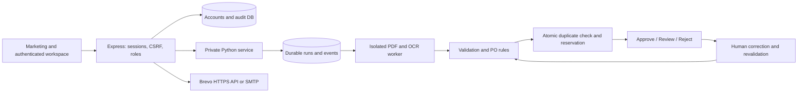
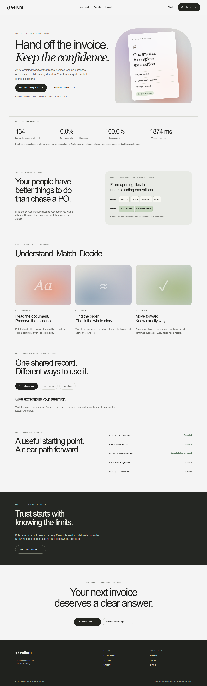
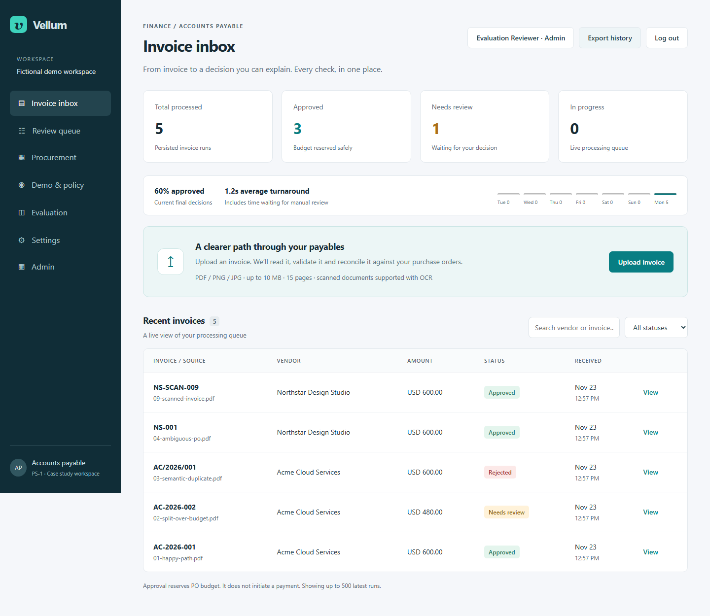

# Vellum Invoice Desk

An invoice is a request to spend against an agreed purchase order. Vellum extracts the document, checks the evidence and remaining commitment, and returns **Approve**, **Review**, or **Reject** with reasons. It never executes a payment.

This assignment implementation includes a marketing website, verified accounts, roles, original document preview, live processing events, review corrections, procurement balances, audit history and downloadable decisions.

Repository: https://github.com/atits23/vellum-invoice-desk

Public deployment: **https://vellum-invoice-desk-atits23.onrender.com**. Verified with real email signup, login, document uploads, OCR, review, dashboard and logout. See [deployment instructions](docs/DEPLOYMENT.md).

## Run locally

Requires Node 22.19+ (including Lighthouse tooling), Python 3.12+, Tesseract (English/Hindi) and Poppler for scans. On the prepared Windows workspace:

```powershell
cd E:\Zamp
.\scripts\start-local.cmd
```

The `.cmd` launcher works when PowerShell script execution is disabled. No machine-wide execution-policy change is needed. Open http://localhost:8000 and keep the terminal running.

For a fresh checkout:

```powershell
python -m venv .venv
.\.venv\Scripts\python.exe -m pip install -r requirements.txt
npm.cmd ci
.\.venv\Scripts\python.exe scripts/generate_samples.py
Copy-Item .env.example .env
.\scripts\start-local.cmd
```

Set `BOOTSTRAP_ADMIN` to your email before signing up. Development prints the single-use verification link to the server terminal. Production requires real email delivery, HTTPS and durable storage. `.env` is ignored by Git. Leave `DATABASE_URL` empty for local SQLite; set it for PostgreSQL. Docker includes the OCR tools: `docker compose up --build`.

## Architecture



SQLite supports local development. Free container hosting uses PostgreSQL for accounts, invoices, source bytes, events and PO reservations. A single worker resumes interrupted jobs after restart. Transaction locks serialize balance reservations. The Python engine listens only on loopback and requires a private credential generated at startup. Server-sent events update the browser from persisted run state.

## Decision rules and difficult inputs

- Required fields, conflicting extraction, date validity, currency and decimal arithmetic are checked before approval.
- Subtotal, tax, discounts, shipping and bounded rounding must reconcile. GST components must agree. No implicit currency or unit conversion.
- Vendor identity and tax ID must agree with the fictional procurement master. Name variants and suspicious same-value repeats require review.
- Explicit unknown POs are never silently substituted. Missing references are inferred only when exactly one eligible PO exists.
- Cumulative gross spend must fit the PO plus the configured allowance: the greater of 2% (default) or the absolute allowance. Split invoices share one balance.
- Item description, unit price and cumulative quantity are checked, including repeated lines within one invoice. Matching uses curated synonyms and lexical similarity, not embeddings.
- Exact file or vendor/reference duplicates are rejected. Unknown layouts, credit notes, proformas, OCR and uncertainty go to review. Malformed and explicit non-invoice documents are rejected.
- A reviewer must inspect the original and record a note; corrections rerun all rules. Verification does not override a failed budget or identity rule.
- PDF, PNG and JPEG limits: 10 MB upload, 15 PDF pages, 25 million image pixels, parser timeout, and bounded stored uploads. Text embedded in documents never becomes executable instructions.

## Measured evaluation

The committed [report](reports/evaluation.html) and [JSON](reports/evaluation.json) were produced by the actual processing service using the [manifest](tests/corpus/manifest.csv). Labels were authored independently of engine output. The 134 files include 131 controlled synthetic variants and three public fictional upstream fixtures under MIT. Variants are correlated; this is a regression corpus, not a representative real-world benchmark.

| Metric | Before | After |
|---|---:|---:|
| Decision routing accuracy | 97.76% | 100% (134/134) |
| False approvals on unsafe inputs | 0 | 0/122 |
| Straight-through approval | 8.21% | 8.96% (12/134) |
| External field extraction | 10.53% | 10.53% |

The low external extraction score is a material limitation. Safe review routing is not successful automatic extraction. All scans deliberately require review. Per-field scores, confusion matrix, precision/recall, OCR confidence and latency p50/p95 are in the report. [Before report](reports/before.html).

## Verification

```powershell
.\.venv\Scripts\python.exe -m unittest discover -s tests -v
npm.cmd test
npm.cmd run check
npm.cmd run test:e2e
.\.venv\Scripts\python.exe scripts/evaluate.py evaluation --require-zero-false-approves
```

Install browser binaries once with `npx.cmd playwright install chromium`. [GitHub Actions](.github/workflows/ci.yml) runs unit/integration, PostgreSQL, browser, corpus and Docker checks. See [verification status](docs/VERIFICATION.md) for what has actually passed.

## Screenshots




## Scope and limitations

This is one shared demonstration workspace, with Admin, Reviewer and Uploader roles. Uploaders see their own runs; reviewers/admins can inspect the workspace. Procurement is fictional seeded data. Email inbox ingestion, ERP synchronization and payment execution are not implemented. The contact form stores an inquiry; it does not book a meeting.

Free services can sleep and impose storage, compute and email limits. The app does not claim financial certification, universal invoice understanding, legal compliance, malware scanning, SSO/MFA, or a tamper-proof audit archive. Arbitrary layouts, handwriting and unseen scripts remain human-review work. Use fictional inputs in the public demonstration. Account deletion does not delete accounting/audit records.

See [design](docs/DESIGN.md), [security](SECURITY.md), [deployment](docs/DEPLOYMENT.md), [contributing](CONTRIBUTING.md) and the [five-minute recording script](docs/DEMO_VIDEO.md).
